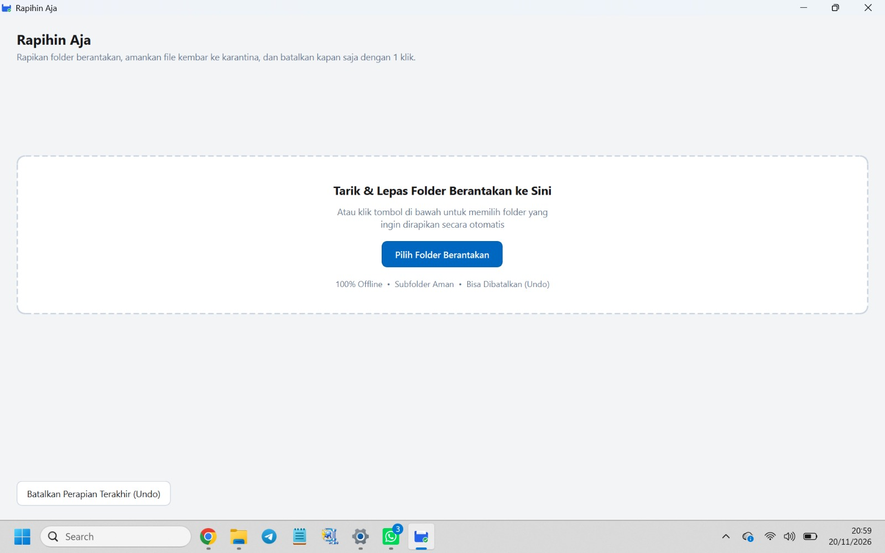
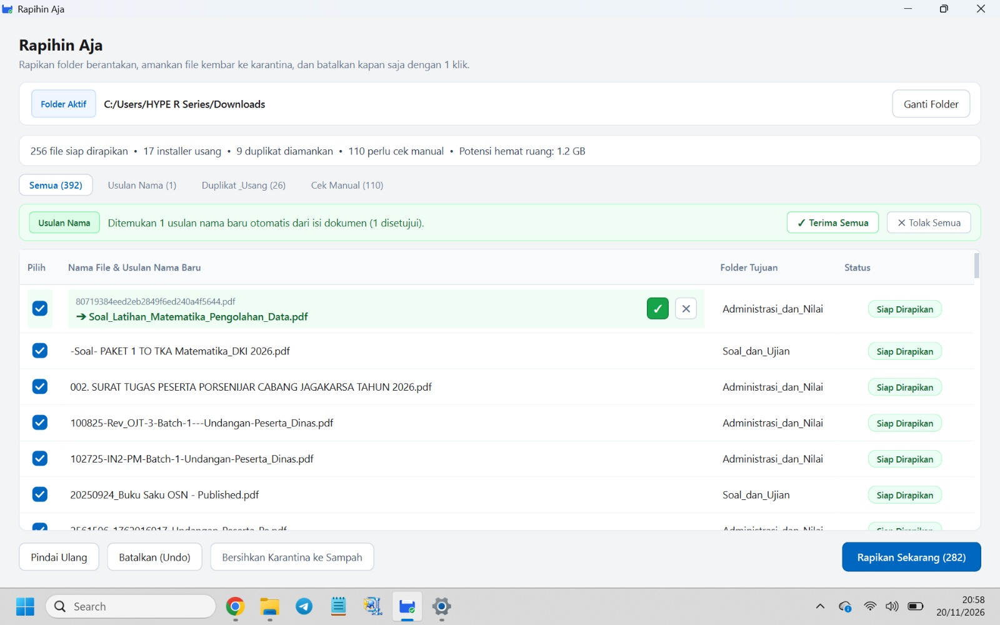
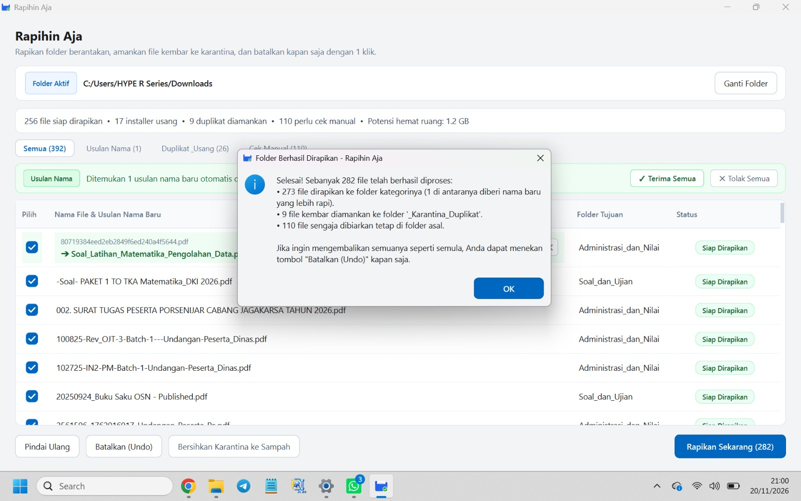
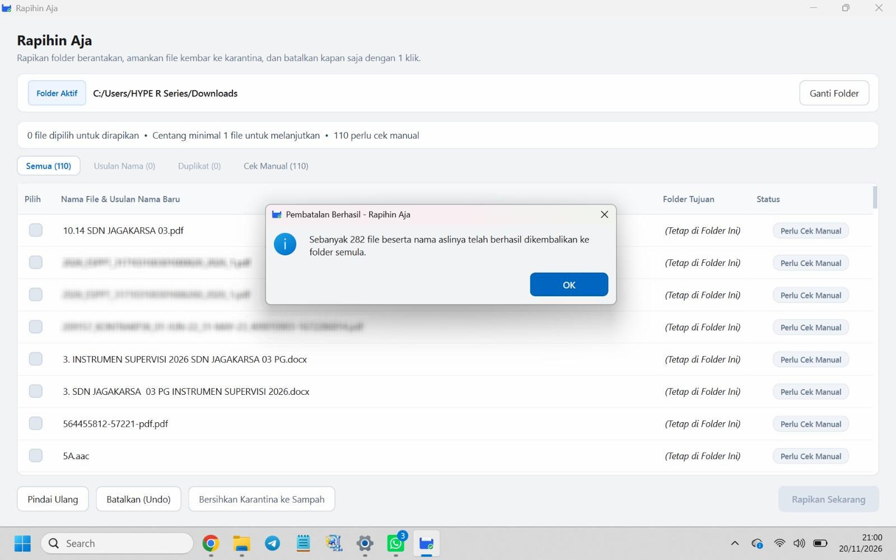

# Rapihin Aja

**Rapihin Aja** adalah aplikasi desktop berbasis **Python** dan **PyQt6** yang **100% offline** untuk merapikan folder berantakan dalam satu klik, memberi nama baru otomatis pada dokumen generik dari isi berkas, mengamankan file duplikat ke folder karantina, serta memulihkan seluruh perubahan kapan saja melalui **Batalkan (Undo)**.

---

## Fitur Utama

- **Kategorisasi Cerdas Berbasis Data:** Memilah file di tingkat utama folder ke 7 folder kategori berprioritas (`Administrasi_dan_Nilai`, `Soal_dan_Ujian`, `Materi_dan_Bahan_Ajar`, `Media_dan_Presentasi`, `Aplikasi_dan_Arsip`, `Dokumen_Lainnya`, dan `_Karantina_Duplikat`) **tanpa menyentuh subfolder** yang sudah ada.
- **Offline *Smart Rename* (`.pdf` & `.docx`):** Membaca judul/kop dokumen pada berkas bernama generik (seperti `DOC-...-WA....pdf` atau `CamScanner_....pdf`) secara lokal tanpa internet, lalu menampilkan usulan nama baru ala pratinjau dokumen dengan tombol setujui (`✓`) atau tolak (`✕`) per baris maupun massal.
- **Deteksi Duplikat (SHA-256) & Installer Usang:** Mempertahankan file bernama paling deskriptif, mengamankan file kembar ke `_Karantina_Duplikat/`, menandai installer lama, serta menghitung estimasi ruang penyimpanan yang bisa dihemat.
- **Pembersihan Aman ke Tempat Sampah:** Tombol **Bersihkan Karantina ke Sampah** memindahkan file karantina melalui `send2trash` ke *Recycle Bin* / *Trash*—tidak pernah menghapus permanen.
- **Kontrol Penuh & Pengaman Sistem:** Memblokir folder sistem kritis OS dan akar folder pengguna, mendukung pengecualian file via kotak centang, menyediakan filter tab (`Semua`, `Usulan Nama`, `Duplikat`/`Duplikat & Usang`, `Cek Manual`), dan membiarkan file yang tidak terbaca di tempat asal (*safe-skip*).
- **1-Click Undo:** Mencatat setiap perpindahan dan perubahan nama ke riwayat lokal agar seluruh file beserta nama aslinya dapat dikembalikan kapan saja dengan menekan **Batalkan (Undo)**.

---

## Tampilan Aplikasi

| 1. Halaman Awal (*Welcome State*) | 2. Pratinjau & Filter Folder Terpilih |
| :---: | :---: |
|  |  |
| Tampilan awal (*Welcome State*) yang bersih dan 100% offline. | Pratinjau file, usulan nama baru otomatis, filter tab, dan estimasi hemat ruang. |

| 3. Hasil Perapian (*Clean Up*) | 4. Pemulihan 1 Klik (*Undo*) |
| :---: | :---: |
|  |  |
| Ringkasan hasil setelah menekan **Rapikan Sekarang**. | Pemulihan file dan nama asli lewat **Batalkan (Undo)**. |

---

## Cara Unduh & Instalasi

### A. Pengguna Umum — Unduh Rilis Siap Pakai (Direkomendasikan)

Unduh paket instalasi sesuai sistem operasi Anda langsung dari halaman [**GitHub Releases**](https://github.com/azzamtermos/ddp1g-26-15/releases):

#### 1. Windows 64-bit (`rapihin-aja-windows-x64.zip`)
1. Unduh **`rapihin-aja-windows-x64.zip`** dari halaman Releases.
2. Ekstrak file ZIP ke folder pilihan Anda, buka folder `rapihin-aja`, lalu klik dua kali **`rapihin-aja.exe`**.
3. **Catatan Windows SmartScreen:** Karena rilis Beta belum memiliki sertifikat tanda tangan digital berbayar (*code-signing*), Windows Defender SmartScreen dapat memunculkan peringatan *"Windows protected your PC"*. Klik **More info** lalu pilih **Run anyway** untuk menjalankan **Rapihin Aja**.

#### 2. Linux — Debian / Ubuntu `amd64` (`rapihin-aja_0.3.0_amd64.deb`)
1. Unduh **`rapihin-aja_0.3.0_amd64.deb`** dari halaman Releases.
2. Pasang paket melalui terminal:
   ```bash
   sudo apt install ./rapihin-aja_0.3.0_amd64.deb
   ```
3. Jalankan **Rapihin Aja** dari menu aplikasi desktop atau melalui terminal dengan perintah `rapihin-aja`.

#### 3. macOS — Apple Silicon (`rapihin-aja-macos-arm64.zip`)
1. Unduh **`rapihin-aja-macos-arm64.zip`** dari halaman Releases.
2. Ekstrak arsip ZIP, lalu pindahkan **`Rapihin Aja.app`** ke folder **Applications**.
3. **Catatan macOS Gatekeeper:** Jika macOS menolak membuka aplikasi karena pengembang belum terdaftar (*unidentified developer*), klik kanan pada **`Rapihin Aja.app`** → pilih **Open** → klik **Open** pada jendela konfirmasi. Alternatifnya, jalankan perintah berikut di Terminal:
   ```bash
   xattr -cr "/Applications/Rapihin Aja.app"
   ```

---

### B. Mode *Development* (Menjalankan dari Kode Sumber)

Pastikan **Python 3.11+** sudah terpasang, lalu jalankan langkah berikut dari direktori proyek:

1. **Buat dan aktifkan *virtual environment*:**
   - **Linux / macOS:**
     ```bash
     python3 -m venv .venv
     source .venv/bin/activate
     ```
   - **Windows (PowerShell):**
     ```powershell
     python -m venv .venv
     .venv\Scripts\Activate.ps1
     ```

2. **Pasang seluruh dependensi:**
   ```bash
   pip install -r requirements.txt
   ```

3. **Jalankan aplikasi:**
   ```bash
   python main.py
   ```

4. **Opsional — Buat folder simulasi & jalankan pengujian unit:**
   ```bash
   # Membuat folder demo_sandbox/ berisi contoh file realistis
   python scripts/seed_demo.py

   # Menjalankan seluruh unit test
   pytest -v
   ```

---

## Struktur Proyek Ringkas

```text
ddp1g-26-15/
├── main.py                         # Entry point aplikasi Rapihin Aja
├── requirements.txt                # Daftar dependensi Python
├── core/                           # Mesin inti: scanner, Smart Rename, SHA-256 duplikat, organizer, safety & paths
├── ui/                             # Antarmuka PyQt6 (Windows 11 Fluent + Notion), QThread workers & styles.qss
├── data/                           # Aturan kategori dan ekstraksi dokumen berbasis JSON
├── assets/                         # Ikon aplikasi (.png & .ico)
├── scripts/                        # Generator demo_sandbox dan skrip packaging (.deb / Windows .exe)
├── docs/                           # Dokumen proposal dan acuan desain UI
├── pics/                           # Tangkapan layar aplikasi untuk dokumentasi README
├── tests/                          # Pengujian unit otomatis (pytest)
└── .github/workflows/release.yml   # Workflow build & rilis GitHub lintas OS
```
