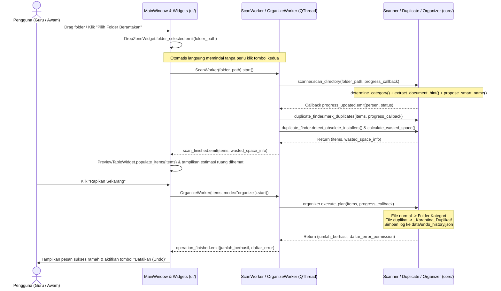

# Proposal Arsitektur & Rencana Kerja (Implementation Plan) — Versi 0.2 (Final)
**Proyek Kelompok DDP 1: Smart File Organizer (Python & PyQt6)**

---

## Ringkasan Kepatuhan Standar Proyek (`.agent/skills/`)
Proposal ini dirancang dengan mematuhi seluruh aturan proyek di folder `.agent/skills/` serta penyempurnaan alur teknis dan pipeline AI Hybrid:
1. **`pyqt6-architecture`**:
   - Pemisahan ketat antara antarmuka (`ui/`) dan logika manipulasi file (`core/`). Modul `ui/` sama sekali tidak mengimpor `os`, `shutil`, atau `pathlib` untuk operasi file, sedangkan modul `core/` sama sekali tidak mengimpor `PyQt6` (komunikasi progres menggunakan `Callable[[int, str], None]`).
   - Seluruh operasi berat (pemindaian folder, kalkulasi hash SHA-256, deteksi installer usang, ekstraksi dokumen/AI renaming, dan pemindahan file) dijalankan di *background thread* menggunakan `QThread` agar aplikasi bebas *freeze* (*Not Responding*).
   - Seluruh pengaturan warna, font, dan *padding* dipisahkan ke dalam `ui/styles.qss`.
   - Kode ramah tingkat DDP1 dengan *type hints* lengkap dan *docstring* berbahasa Indonesia pada setiap *class* serta *method* utama.
2. **`modern-pyqt-ux`**:
   - Palet warna lembut & modern: latar belakang `#F8FAFC`, permukaan kartu `#FFFFFF` dengan border `#E2E8F0`, tombol utama biru `#2563EB` (hover `#1D4ED8`).
   - Sudut membulat (`border-radius: 8px` untuk tombol/input, `12px` untuk kartu), jarak antar-elemen lega (`spacing >= 12px`, `margin >= 24px`), dan font modern (`Segoe UI`, `Inter`, `Ubuntu`) ukuran minimal `13px` (judul `18px–20px` *bold*).
   - Bahasa manusiawi yang ramah guru/pengguna awam: **"Pilih Folder Berantakan"**, **"Pindai Ulang (Refresh)"**, **"Rapikan Sekarang"**, **"Batalkan (Undo)"**, dan **"Bersihkan Karantina ke Sampah"**.
   - Begitu pengguna melakukan *drag-and-drop* atau memilih folder melalui **"Pilih Folder Berantakan"**, pemindaian (`ScanWorker`) langsung berjalan otomatis mengisi tabel *preview* tanpa perlu klik tombol kedua.
3. **`safe-file-ops`**:
   - Seluruh manipulasi path wajib menggunakan `pathlib.Path` (lintas platform Windows & Linux, tanpa penggabungan string `+`).
   - **Skema Karantina Duplikat & 100% Undo-able:** Saat **"Rapikan Sekarang"** dijalankan, file duplikat dipindahkan ke subfolder lokal `_Karantina_Duplikat/` dan dicatat ke log transaksi agar fitur **"Batalkan (Undo)"** dapat memulihkan 100% file (termasuk duplikat) menggunakan `pathlib.Path.rename()`.
   - **Pembersihan ke Recycle Bin (`send2trash`):** Dilarang keras menggunakan `os.remove()`, `os.unlink()`, atau `shutil.rmtree()`. Disediakan metode khusus `empty_quarantine_to_trash()` yang menggunakan library `send2trash` ketika pengguna ingin membuang isi folder `_Karantina_Duplikat/` ke *Recycle Bin*.
   - **Log Transaksi Otomatis Saat Runtime & Keamanan API Key:** File `data/undo_history.json` dan `.env` diabaikan di `.gitignore` (agar bebas *merge conflict* dan menjaga kerahasiaan API Key AI). File `data/undo_history.json` otomatis dibuat saat *runtime* oleh `SafeFileOrganizer` jika belum ada.
   - Penanganan konflik nama otomatis dengan penomoran (`_1`, `_2`, dst.) tanpa menimpa file lama, serta penanganan `PermissionError` secara anggun tanpa membuat aplikasi *crash*.

---

## 1. Struktur Folder dan File Lengkap

```text
ddp1g-26-15/
├── .gitignore                   # Mengabaikan data/undo_history.json, .env, __pycache__/, .venv/, .pytest_cache/
├── main.py                      # Entry point aplikasi: inisialisasi QApplication, muat styles.qss, buka MainWindow
├── requirements.txt             # Daftar dependensi (PyQt6, Send2Trash, pypdf, python-dotenv, pytest)
├── docs/                        # Arsip dokumen perencanaan & arsitektur tim
│   ├── proposal_0_1.md          # Arsip proposal versi pertama
│   └── proposal_0_2.md          # Dokumen proposal arsitektur & rencana kerja final (versi 0.2)
├── ui/                          # Paket Antarmuka Pengguna (HANYA tampilan & event UI, tanpa os/shutil/pathlib)
│   ├── __init__.py
│   ├── main_window.py           # Jendela utama (MainWindow) yang menyatukan seluruh komponen & mengatur QThread
│   ├── widgets.py               # Komponen visual kustom: DropZoneWidget (drag-and-drop) & PreviewTableWidget
│   ├── worker.py                # Subclass QThread untuk menjalankan proses core/ di background + real-time progress
│   └── styles.qss               # Lembar gaya terpusat (palet warna #F8FAFC, #2563EB, border-radius, font, padding)
├── core/                        # Paket Logika Bisnis & Manipulasi File (menggunakan pathlib.Path & send2trash)
│   ├── __init__.py
│   ├── models.py                # Dataclass kontrak data antar-modul (FilePlanItem dengan proposed_name, TransactionRecord)
│   ├── scanner.py               # Pemindai folder, kategorisasi, ekstraksi teks PDF, & AI Hybrid Smart Renaming
│   ├── duplicate_finder.py      # Pendeteksi duplikat (SHA-256), installer usang, & kalkulator penghematan ruang
│   └── organizer.py             # Eksekutor pemindahan, karantina duplikat, send2trash karantina, & Undo JSON
├── data/                        # Penyimpanan aturan & riwayat transaksi lokal
│   ├── .gitkeep                 # Menjaga folder data/ tetap terlacak di Git
│   ├── default_rules.json       # Aturan pengelompokan kategori folder default (Dokumen Guru, Gambar, Arsip, dll.)
│   └── (undo_history.json)      # Dibuat otomatis saat runtime oleh SafeFileOrganizer (masuk .gitignore)
└── tests/                       # Paket pengujian unit (Unit Tests) untuk setiap modul core/
    ├── __init__.py
    ├── test_scanner.py
    ├── test_duplicate_finder.py
    └── test_organizer.py
```

---

## 2. Rancangan Class, Method, dan Alur Signals & Slots (`ui/` ↔ `core/`)

### A. Kontrak Data (`core/models.py`)
Mendukung perbandingan nama file asli (`file_name`) dan usulan nama baru (`proposed_name`) baik dari aturan lokal maupun AI Renaming:

```python
from dataclasses import dataclass

@dataclass
class FilePlanItem:
    """Representasi rencana perapian untuk satu file yang dipindai."""
    source_path: str              # Path asli file (string dari pathlib.Path)
    file_name: str                # Nama file asli beserta ekstensinya
    proposed_name: str            # Nama file baru hasil usulan (aturan lokal / AI Hybrid, fallback ke file_name)
    file_size: int                # Ukuran file dalam bytes (untuk optimasi cek duplikat & ruang hemat)
    category: str                 # Kategori tujuan (misal: "Dokumen_Ajar", "_Karantina_Duplikat")
    proposed_path: str            # Rencana path lengkap tujuan setelah dirapikan
    is_duplicate: bool = False    # True jika terdeteksi sebagai duplikat
    is_obsolete_temp: bool = False # True jika terdeteksi sebagai file installer/sementara yang usang
    status_label: str = "Siap Dirapikan"  # "Siap Dirapikan" (Hijau) / "File Duplikat" (Oranye) / "Installer Usang" (Kuning)

@dataclass
class TransactionRecord:
    """Catatan satu transaksi perpindahan file untuk riwayat Undo."""
    old_path: str
    new_path: str
    timestamp: str = ""
```

### B. Kerangka Modul Logika (`core/`) — Placeholder dengan Dukungan Real-Time Progress & Hybrid AI
Seluruh fungsi di `core/` disiapkan sebagai *skeleton/placeholder* dengan *type hints*, parameter `progress_callback: Callable[[int, str], None] | None = None`, dan *docstring* Bahasa Indonesia yang jelas:

1. **`core/scanner.py` — `class FolderScanner`**
   - `__init__(self, rules_path: str = "data/default_rules.json") -> None`: Memuat aturan pengelompokan ekstensi dan kata kunci dari file JSON menggunakan `pathlib.Path`.
   - `scan_directory(self, folder_path: str, progress_callback: Callable[[int, str], None] | None = None) -> list[FilePlanItem]`: Memindai seluruh file tingkat pertama di dalam `folder_path` (mengabaikan subfolder kategori dan `_Karantina_Duplikat/`), memanggil `progress_callback(persen, pesan)` secara berkala, lalu mengembalikan daftar `FilePlanItem`.
   - `determine_category(self, file_path: Path) -> str`: Menentukan kategori folder berdasarkan ekstensi dan kata kunci nama/isi file (misal: RPP, Silabus, Nilai, Soal).
   - `extract_document_hint(self, file_path: Path) -> str | None`: *(Placeholder fitur lanjutan)* Membaca halaman pertama PDF/dokumen untuk mendeteksi kata kunci/judul dokumen.
   - `propose_smart_name(self, file_path: Path, doc_hint: str | None = None) -> str`: *(Placeholder Pipeline AI Hybrid)* Mengusulkan nama file baru yang rapi dan deskriptif berdasarkan `doc_hint` atau metadata (dapat diintegrasikan dengan API AI seperti Qwen menggunakan konfigurasi `.env` / `python-dotenv`, dengan *fallback* otomatis ke `file_path.name` jika sedang offline atau API key tidak tersedia).

2. **`core/duplicate_finder.py` — `class DuplicateFinder` (Porsi Kerja Seimbang untuk Anggota 3)**
   - `calculate_file_hash(self, file_path: Path, chunk_size: int = 65536) -> str`: Menghitung nilai hash SHA-256 dari isi file secara bertahap per *chunk* agar aman untuk file berukuran besar.
   - `mark_duplicates(self, items: list[FilePlanItem], progress_callback: Callable[[int, str], None] | None = None) -> list[FilePlanItem]`: Mengelompokkan item berdasarkan `file_size`, membandingkan hash SHA-256 pada ukuran yang sama, memanggil `progress_callback`, serta mengubah `is_duplicate = True`, `category = "_Karantina_Duplikat"`, `proposed_path` ke dalam folder `_Karantina_Duplikat/`, dan `status_label = "File Duplikat"`.
   - `detect_obsolete_installers(self, items: list[FilePlanItem], age_days: int = 30) -> list[FilePlanItem]`: Memeriksa file berekstensi installer/sementara (`.exe`, `.msi`, `.dmg`, `.deb`, `.apk`, `.tmp`, `.crdownload`) yang usianya melebihi `age_days`, lalu menandai `is_obsolete_temp = True` dan `status_label = "Installer Usang"`.
   - `calculate_wasted_space(self, items: list[FilePlanItem]) -> dict[str, int | str]`: Menghitung total estimasi ruang penyimpanan yang bisa dihemat dari file duplikat dan installer usang (mengembalikan dictionary berisi `total_bytes`, `duplicate_count`, `obsolete_count`, dan `formatted_size` seperti `"124.5 MB"` untuk ditampilkan di ringkasan UI).

3. **`core/organizer.py` — `class SafeFileOrganizer`**
   - `__init__(self, undo_log_path: str = "data/undo_history.json") -> None`: Menyiapkan path penyimpanan log transaksi Undo dan memanggil `_ensure_undo_log_exists()` agar file `data/undo_history.json` otomatis dibuat saat *runtime* jika belum ada.
   - `_ensure_undo_log_exists(self) -> None`: Membuat folder `data/` dan file `undo_history.json` berisi `[]` jika belum tersedia di komputer pengguna/anggota tim.
   - `resolve_conflict_path(self, target_path: Path) -> Path`: Memeriksa apakah `target_path` sudah ada; jika sudah ada, menghasilkan nama baru dengan penomoran otomatis (`nama_1.pdf`, `nama_2.pdf`, dst.) tanpa menimpa file lama.
   - `save_undo_log(self, transactions: list[dict[str, str]]) -> None`: Menyimpan daftar transaksi `{"old_path": "...", "new_path": "..."}` ke `data/undo_history.json` sebelum/saat pemindahan berlangsung.
   - `execute_plan(self, items: list[FilePlanItem], progress_callback: Callable[[int, str], None] | None = None) -> tuple[int, list[str]]`: Mengeksekusi pemindahan file normal ke folder kategorinya dan memindahkan file duplikat ke folder lokal `_Karantina_Duplikat/` menggunakan `pathlib.Path.rename()` (sehingga 100% dapat dipulihkan lewat fitur Undo), melaporkan progres lewat `progress_callback`, mencatat log Undo, serta menangkap `PermissionError` agar aplikasi tidak *crash*.
   - `undo_last_operation(self) -> tuple[int, list[str]]`: Membaca `data/undo_history.json` dan mengembalikan 100% file (baik file kategori maupun file dari `_Karantina_Duplikat/`) dari `new_path` ke `old_path` menggunakan `pathlib.Path.rename()`.
   - `empty_quarantine_to_trash(self, base_folder_path: str) -> tuple[int, list[str]]`: Memindahkan seluruh file di dalam `_Karantina_Duplikat/` ke *Recycle Bin* / *Trash* sistem operasi secara aman menggunakan `send2trash.send2trash()`.

### C. Rancangan Komponen Antarmuka & Worker Thread (`ui/`)
Sesuai dokumentasi resmi **PyQt6** (terverifikasi via Context7 `/websites/riverbankcomputing_static_pyqt6`), seluruh `pyqtSignal` dideklarasikan sebagai *class attribute* pada subclass `QObject` / `QThread`:

1. **`ui/widgets.py`**
   - `class DropZoneWidget(QFrame)`:
     - Signal: `folder_selected = pyqtSignal(str)`
     - Method: `dragEnterEvent`, `dropEvent`, `_on_browse_clicked()` (membuka `QFileDialog.getExistingDirectory` melalui tombol **"Pilih Folder Berantakan"** dan langsung memancarkan `folder_selected`).
   - `class PreviewTableWidget(QTableWidget)`:
     - Method: `populate_items(self, items: list[FilePlanItem]) -> None` (menampilkan kolom *Nama Asli*, *Usulan Nama Baru*, *Kategori Tujuan*, dan *Status* dengan badge warna hijau `#DCFCE7` / teks `#166534` untuk `"Siap Dirapikan"` dan kuning/oranye `#FEF3C7` / teks `#92400E` untuk `"File Duplikat"` atau `"Installer Usang"`).

2. **`ui/worker.py`**
   - `class ScanWorker(QThread)`:
     - Signals:
       - `progress_updated = pyqtSignal(int, str)`
       - `scan_finished = pyqtSignal(list, dict)` *(mengirimkan `list[FilePlanItem]` dan ringkasan `wasted_space_info` dari `calculate_wasted_space`)*
       - `error_occurred = pyqtSignal(str)`
     - Method: `run(self) -> None`: Meneruskan `self.progress_updated.emit` sebagai `progress_callback` ke `FolderScanner.scan_directory()` dan `DuplicateFinder.mark_duplicates()`, lalu memanggil `detect_obsolete_installers()` serta `calculate_wasted_space()`.
   - `class OrganizeWorker(QThread)`:
     - Signals:
       - `progress_updated = pyqtSignal(int, str)`
       - `operation_finished = pyqtSignal(int, list)` *(mengirimkan `jumlah_berhasil` dan `daftar_error`)*
       - `error_occurred = pyqtSignal(str)`
     - Method: `run(self) -> None`: Menjalankan `SafeFileOrganizer.execute_plan(..., progress_callback=self.progress_updated.emit)`, `undo_last_operation()`, atau `empty_quarantine_to_trash()` sesuai mode aksi.

3. **`ui/main_window.py` — `class MainWindow(QMainWindow)`**
   - **Alur UX Otomatis:** Saat `DropZoneWidget` memancarkan `folder_selected(folder_path)`, `MainWindow` **langsung menjalankan `ScanWorker`** secara otomatis untuk mengisi tabel *preview* dan menampilkan bar progres (`QProgressBar`) *real-time* beserta info estimasi penghematan ruang penyimpanan.
   - Menyediakan bar tombol tindakan dengan label ramah pengguna:
     - **"Pilih Folder Berantakan"** (di dalam DropZone)
     - **"Pindai Ulang (Refresh)"** (memindai ulang folder aktif kapan saja)
     - **"Rapikan Sekarang"** (menjalankan pemindahan & karantina duplikat)
     - **"Batalkan (Undo)"** (memulihkan 100% file dari `undo_history.json`)
     - **"Bersihkan Karantina ke Sampah"** (memanggil `empty_quarantine_to_trash()` via `send2trash`)

### D. Diagram Alur Signals & Slots (`ui/` ↔ `QThread` ↔ `core/`)



---

## 3. Pembagian Modul Tim (4 Anggota — Bebas Merge Conflict & Beban Kerja Seimbang)

| Anggota | Peran & Modul | File yang Dikerjakan (Eksklusif) | Lingkup Tugas Detail |
| :--- | :--- | :--- | :--- |
| **Anggota 1** | **UI/UX, QSS & Threading Integrator** | `main.py`, `ui/main_window.py`, `ui/widgets.py`, `ui/worker.py`, `ui/styles.qss` | Membangun antarmuka PyQt6 modern, area *drag-and-drop* yang langsung memicu *auto-scan*, `QProgressBar` *real-time*, tabel *preview* ber-badge warna, tombol **"Pindai Ulang (Refresh)"**, serta integrasi `QThread`. |
| **Anggota 2** | **Folder Scanner, Smart Categorizer & AI Renamer** | `core/scanner.py`, `data/default_rules.json`, `tests/test_scanner.py` | Mengimplementasikan pemindaian direktori berbasis `pathlib.Path` dengan `progress_callback`, aturan pengelompokan file guru, ekstraksi teks PDF (`extract_document_hint`), dan penamaan pintar (`propose_smart_name` via aturan lokal / API AI dengan fallback offline). |
| **Anggota 3** | **Duplicate, Storage Analyzer & Obsolete Detector** | `core/duplicate_finder.py`, `tests/test_duplicate_finder.py` | Mengimplementasikan deteksi file duplikat dua tahap (ukuran file + hashing `hashlib.sha256` per *chunk*) dengan `progress_callback`, penandaan file installer/sementara yang usang (`detect_obsolete_installers`), dan kalkulasi estimasi ruang penyimpanan yang dihemat (`calculate_wasted_space`). |
| **Anggota 4** | **Safe File Organizer, Quarantine & 1-Click Undo** | `core/organizer.py`, `tests/test_organizer.py` | Mengimplementasikan inisialisasi otomatis `data/undo_history.json` saat *runtime*, pemindahan file dengan `progress_callback`, karantina duplikat ke `_Karantina_Duplikat/`, penomoran otomatis konflik nama (`_1`, `_2`), pemulihan 100% file via Undo, pembersihan karantina ke *Recycle Bin* (`empty_quarantine_to_trash` via `send2trash`), dan penanganan `PermissionError`. |

---

## 4. Tahapan Eksekusi Blueprint (4 Fase Git Commit Bertahap)

### Fase 1: Fondasi Proyek, `.gitignore`, Konfigurasi Data & Kontrak Model
- **File yang dibuat:** `.gitignore` (mengabaikan `data/undo_history.json`, `.env`, `__pycache__/`, `.venv/`), `requirements.txt` (termasuk `python-dotenv`), `core/__init__.py`, `core/models.py` (dengan `proposed_name`), `data/.gitkeep`, `data/default_rules.json`.
- **Rekomendasi pesan commit:** `chore: initialize project structure, gitignore, dependencies, and core data models`

### Fase 2: Kerangka Modul Logika `core/` (Placeholder Ber-docstring & Progress Callback)
- **File yang dibuat:** `core/scanner.py` (termasuk `propose_smart_name`), `core/duplicate_finder.py`, `core/organizer.py`.
- **Rekomendasi pesan commit:** `feat(core): add skeleton classes for scanner, duplicate analyzer, and safe organizer`

### Fase 3: Antarmuka PyQt6 Modern, Auto-Scan UX, QSS & Background Worker
- **File yang dibuat:** `ui/__init__.py`, `ui/styles.qss`, `ui/widgets.py`, `ui/worker.py`, `ui/main_window.py`, `main.py`.
- **Rekomendasi pesan commit:** `feat(ui): implement modern PyQt6 interface with auto-scan, real-time progress, and QSS`

### Fase 4: Kerangka Pengujian Unit (`tests/`)
- **File yang dibuat:** `tests/__init__.py`, `tests/test_scanner.py`, `tests/test_duplicate_finder.py`, `tests/test_organizer.py`.
- **Rekomendasi pesan commit:** `test: add unit test templates for scanner, duplicate finder, and safe organizer`
